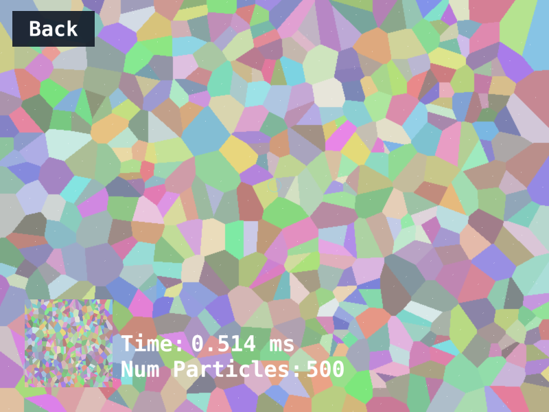
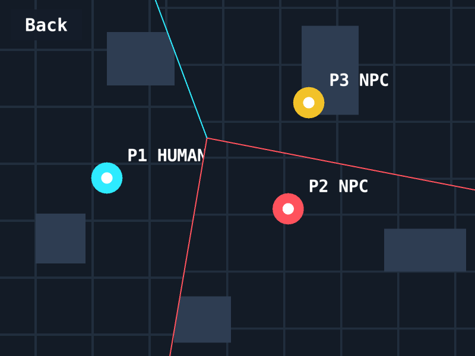

# defold-voronoi

A small extension for Defold to add 2D voronoi functionality

[Try the bundled HTML5 demo.](https://jcash.github.io/defold-voronoi/)

Uses the C/C++ library [jc_voronoi](https://github.com/JCash/voronoi) which
is a fast C implementation for creating 2D Voronoi diagrams from a point set.
The bundled header is jc_voronoi 0.10.0.
Native extensions depending on this library can include the exported header
with `#include <jc_voronoi.h>`.

Uses [Fortune's sweep algorithm.](https://en.wikipedia.org/wiki/Fortune%27s_algorithm)

Tested on iOS, OSX and Windows (should work fine on Android too)

The app starts at a selection screen. Choose **Voronoi Diagram** or
**Split Screen**; the selected collection is loaded through a collection proxy.
Use the **Back** button in either example to unload it and return to the menu.

In the Voronoi Diagram example, press and drag anywhere to grab the site
belonging to the Voronoi cell under the pointer. The site remains locked to the
pointer until release, while its immediate neighbors are displaced to keep the
grabbed cell close to its original area. Hold Up/Down to continuously add or
remove particles at 60 particles per second.

## Examples

The repository includes two focused example collections:

### Voronoi Diagram

`/examples/voronoi/voronoi.collection`

It creates and animates a dense Voronoi
diagram and supports cell grabbing, continuous particle-count changes, and
grabbed-cell area preservation.



### Split Screen

`/examples/multicamera/multicamera.collection`



See [SPLITSCREEN.md](SPLITSCREEN.md) for the example controls, implementation
details, render-script integration guide, and further reading.

# Lua API

This extension adds a Lua module named `voronoi`
and ships editor completion metadata in `/voronoi/voronoi.script_api`.

## voronoi.create(width, height)

Creates and returns a Voronoi diagram context with rectangular bounds.

    self.diagram = voronoi.create(800, 600)

## voronoi.destroy(diagram)

Destroys a diagram context. Do not use it afterward.

## voronoi.generate(diagram, points)

Generates a 2D Voronoi diagram from a flat coordinate array in the form
`{ x1, y1, x2, y2, ... }`. Duplicate sites may be removed.

    local points = { 1.0, 1.5, 2.3, 3.1 }
    voronoi.generate(self.diagram, points)

## voronoi.relax(diagram)

Moves the input points toward the averages of their cells and regenerates the
diagram. Call repeatedly for additional relaxation passes.

## voronoi.get_num_sites(diagram)

Returns the number of unique generated sites. This may be smaller than the
number of supplied points when duplicates were removed.

## voronoi.get_sites(diagram) and voronoi.get_site(diagram, index)

Returns all sites, or the site belonging to a 1-based original input index.
Site tables mirror `jcv_site` and add cell geometry:

- `p` — site position as `{ x, y }`.
- `index` — 1-based index in the original input points.
- `boundary` — `true` when the cell touches the clipping boundary.
- `edges` — counter-clockwise array of the site's edges.
- `area` — signed cell area supplied as a Lua convenience.

Each edge table mirrors `jcv_edge`:

- `sites` — two 1-based input indices; `0` denotes the clipping boundary.
- `pos` — two endpoint tables in the form `{ x, y }`.
- `vertices` — two 1-based indices into `get_vertices()`; `0` means invalid.

For edges returned as part of a site, `edge.sites[1]` is the current site and
`edge.sites[2]` is its neighbor or `0` at the boundary.

```lua
for _, site in ipairs(voronoi.get_sites(self.diagram)) do
    for _, edge in ipairs(site.edges) do
        local neighbor = edge.sites[2]
        local from = edge.pos[1]
        local to = edge.pos[2]
    end
end
```

## voronoi.get_num_vertices(diagram) and voronoi.get_vertices(diagram)

Returns the unique vertex count or the array of unique `{ x, y }` vertices.
The indices in `edge.vertices` refer to this array.

## voronoi.get_edges(diagram)

Returns every diagram edge once, using the edge structure described above.

## voronoi.get_delauney_edges(diagram)

Returns the edges produced by `jcv_delauney_begin()` and
`jcv_delauney_next()`. Each entry mirrors `jcv_delauney_edge` with `edge`,
`sites`, and `pos` fields. The upstream library's `delauney` spelling is kept
in the Lua API.

## voronoi.get_debug_image(diagram)

Gets an RGB image of the diagram. The result is a buffer with a `hash("rgb")`
uint8 stream containing three components per pixel.

    self.textureheader = {width=self.width,
                        height=self.height,
                        type=graphics.TEXTURE_TYPE_2D,
                        format=graphics.TEXTURE_FORMAT_RGB }
    local path = go.get("#sprite", "texture0")
    local image = voronoi.get_debug_image(self.diagram)
    resource.set_texture(path, self.textureheader, image)
